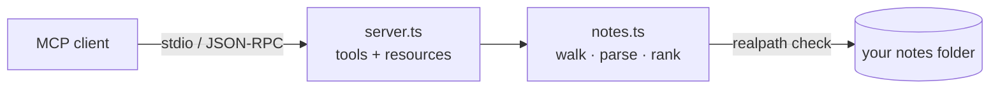

<div align="center">

# 🗒️ notes-mcp

### Your markdown notes, searchable by any AI assistant.

A tiny, **read-only** [Model Context Protocol](https://modelcontextprotocol.io) server that lets your assistant
search, list and read the notes you already keep: an Obsidian vault, a `~/notes` folder, a docs repo.

[](https://github.com/shadow-lo/notes-mcp/actions/workflows/ci.yml)


[Features](#-features) · [Quick start](#-quick-start) · [Tools](#-tools) · [How it works](#-how-it-works) · [Safety](#-safety) · [Development](#-development)

</div>

---

> **You:** what did I decide about the Postgres backups?
>
> **Assistant:** *calls `search_notes`* → In `projects/homelab.md` you decided to move the backup job to the NAS,
> run it nightly at 03:00, and test a restore once a month.

No uploads, no sync service, no database. The server reads the folder you point it at, on your machine, and nothing else.

## ✨ Features

|  |  |
| --- | --- |
| 🔎 **Ranked full-text search** | Every word must match. Title and tag hits rank above body hits, and results come with the matching lines. |
| 🏷️ **Tags that just work** | Reads frontmatter `tags: [a, b]`, YAML lists and inline `#tags`, then lets you filter by any of them. |
| 📂 **Folder-aware** | Walks subfolders, skips `.git`, `.obsidian` and other hidden folders, indexes `.md`, `.markdown` and `.mdx`. |
| 🔒 **Read-only and sandboxed** | No write tools. `../` and symlinks that leave the folder are refused. |
| 📎 **Resources too** | Every note is also an MCP resource at `note:///<path>`, for clients that attach files directly. |
| 🪶 **Two dependencies** | The official MCP SDK and zod. Starts in milliseconds. |

## 🚀 Quick start

```bash
git clone https://github.com/shadow-lo/notes-mcp.git
cd notes-mcp
npm install          # installs and builds dist/
```

Then register it with your MCP client. Most clients accept a config block like this:

```json
{
  "mcpServers": {
    "notes": {
      "command": "node",
      "args": ["/absolute/path/to/notes-mcp/dist/index.js", "/absolute/path/to/your/notes"]
    }
  }
}
```

Restart the client and ask it about your notes. The notes folder can also be set with the `NOTES_DIR`
environment variable instead of the second argument.

<details>
<summary><b>Try it in the MCP Inspector first</b></summary>

```bash
npx @modelcontextprotocol/inspector node dist/index.js examples/notes
```

This opens a local web UI where you can call each tool by hand against the sample notes in `examples/notes`.

</details>

## 🧰 Tools

| Tool | Arguments | Returns |
| --- | --- | --- |
| `search_notes` | `query`, `tag?`, `limit?` (default 10) | Best matches with path, title, tags and up to 3 matching lines |
| `read_note` | `path` | The full markdown of one note |
| `list_notes` | `folder?`, `tag?`, `limit?` (default 100) | Every matching note with title and tags |

All tools are marked `readOnlyHint`, so clients can run them without asking for confirmation each time.

**Example output**

```text
search_notes { "query": "postgres backup" }

1 note(s) match "postgres backup":

- projects/homelab.md — Homelab plan  [#infra #postgres]
    L8: Move the Postgres backup job to the NAS and run it nightly at 03:00.
    L9: Check restore once a month, a backup you never restored is not a backup.
```

**How titles are picked:** frontmatter `title:` → first `# heading` → filename.

## 🧠 How it works



```text
src/
├── index.ts    CLI entry point, stdio transport, logs to stderr only
├── server.ts   MCP tools and resources (thin layer)
└── notes.ts    folder walking, frontmatter, search ranking, path sandbox (no MCP code)
```

Ranking is deliberately simple and predictable: +10 per term found in the title, +5 in a tag, +2 in the path,
and +1 per occurrence in the body (capped at 20 per term).

## 🔒 Safety

- **Read-only.** There is no tool that writes, renames or deletes.
- **Sandboxed paths.** Every path goes through `realpath` and must stay inside the notes folder, so `../secret` and symlinks pointing elsewhere are rejected.
- **Bounded output.** Notes over 1 MB are skipped, so one giant export can't flood the context window.
- **Clean protocol channel.** Logs go to stderr; stdout carries only MCP messages.

## 🧪 Development

```bash
npm test             # vitest: unit tests + an in-memory MCP client/server round trip
npm run typecheck    # tsc --noEmit
npm run build        # compile to dist/
```

CI runs typecheck, tests, build and a real stdio smoke test on Node 20, 22 and 24.

## 📄 License

[MIT](LICENSE) © shadow-lo
